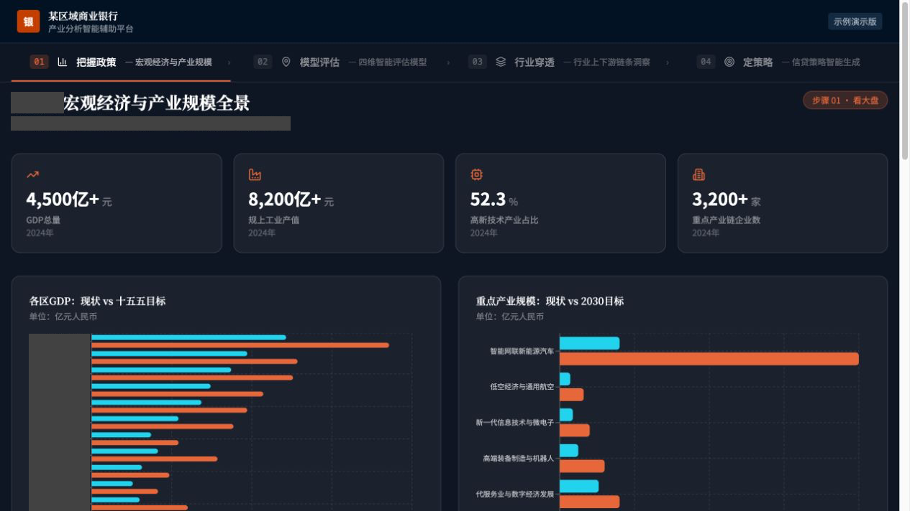
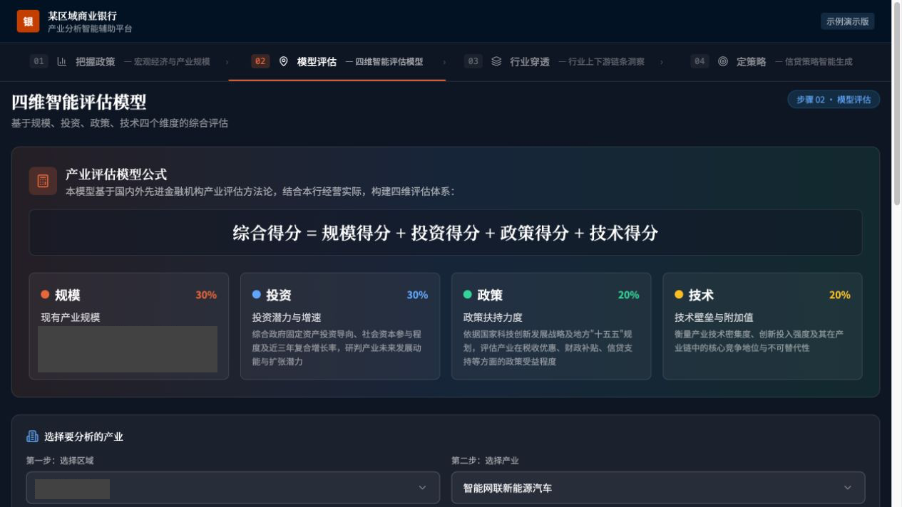
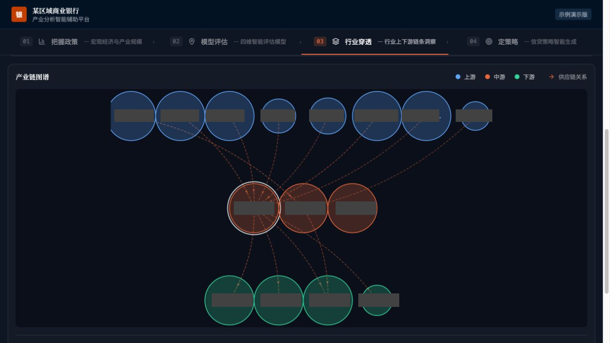

# 2026.04｜第一次 vibe coding

状态：内容草稿，未发布。

## 时间线文案

### 第一次 vibe coding

没有 PM，没有项目背景，也没有任何支持。只有一个做到一半的烂摊子，和迫在眉睫的 DDL。

这是我入职后的第一个项目，留给我的时间只有一天。我用 Claude Code 在已有代码上继续修改，一直干到凌晨四点。地图那一块，花了很久。

具体怎么和 AI 来回协作，已经记不清了。但这就是我 vibe coding 的起点：第一次跟 Agent 共同完成一个项目。

## 截图

以下图片于 2026-09-28 从仓库留存的 dist/public 网页构建在本地重新截取，不是开发当晚的原始截图，也不保证对应首次交付版本。保留界面原貌；在临时网页副本中将银行名称替换为“某区域商业银行”、标志文字替换为“银”。未修改上游仓库。

截图用于展示界面，不作为其中统计数字、评估方法或企业关系的真实性证明。2026-10-08 在原截图上追加不透明色块，遮住地区标题、来源说明、地区坐标轴、含地名的说明及区域选项；产业链图全部企业标签一并遮挡。其他界面保持原样。未宣称对保留的统计数字完成全面数据匿名化。

## 素材来源与局限

- 来源：TobeALeg/YangziBankDemo，dist/public/index.html、assets/index-BthGPkBN.js、assets/index-DIWlFZrh.css。
- 当前留存构建未包含地图，地图暂缺截图；不能用产业链图谱代替地图的经历。
- 本地静态预览未接入评估数据服务，评估截图仅展示方法和选择区域。
- 不补写具体 prompt、协作步骤、技术难点或未经本人确认的学习结论。
- 文案按用户 2026-10-08 最新口述修订，保留“没有 PM、没有项目背景、没有支持、半成品和紧迫 DDL”的主旨。
