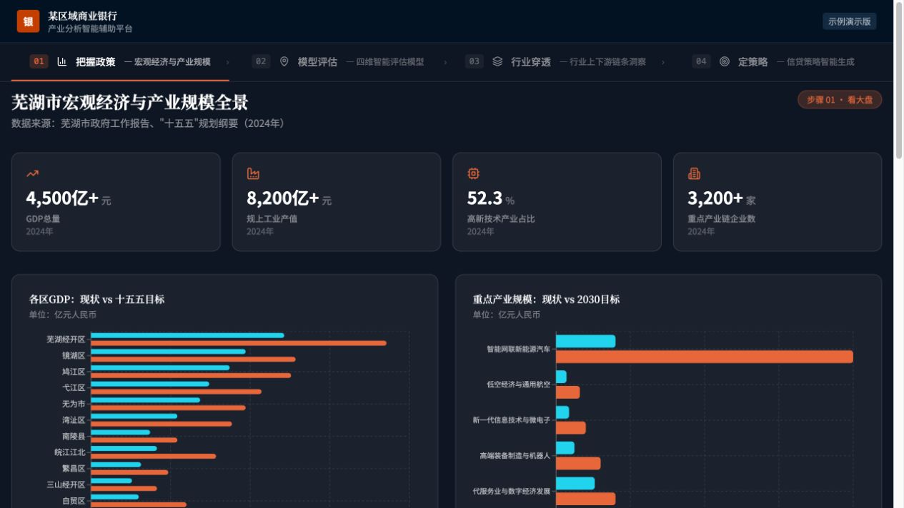
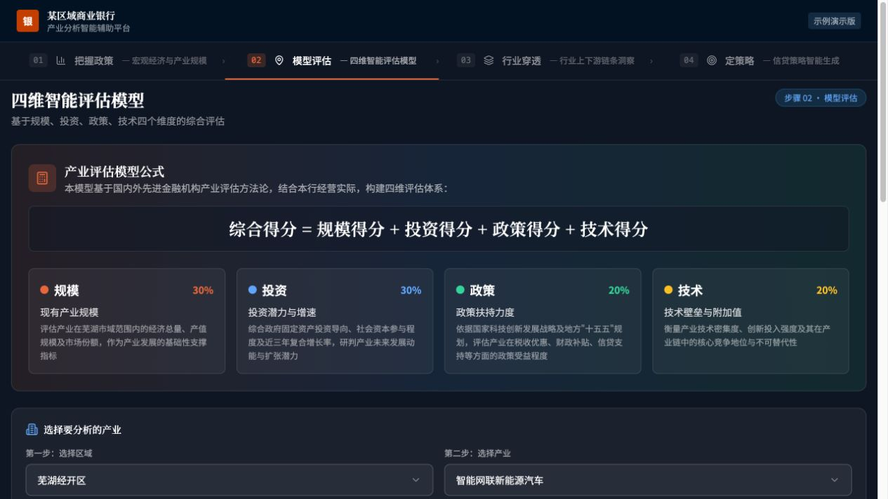

# 2026.04｜第一次与 Agent 共同完成项目

状态：内容草稿，未发布。

## 时间线文案

这是我入职后的第一个项目，也是我 vibe coding 的起点。

印象里，我接手的是老板已经开发到一半的银行产业分析 Demo，需要在已有基础上继续修改。需求只有粗略的功能描述，留给我的时间是一天。我使用 Claude Code 推进项目，最后做到了凌晨四点，地图部分花了很长时间。

当时的具体协作步骤已经记不清，也不是在现在这台电脑上开发的。但我记得，这是我第一次与 Agent 共同完成一个项目。

## 截图

以下图片于 2026-09-28 从仓库留存的 dist/public 网页构建在本地重新截取，不是开发当晚的原始截图，也不保证对应首次交付版本。保留界面原貌；在临时网页副本中将银行名称替换为“某区域商业银行”、标志文字替换为“银”。未修改上游仓库。

截图用于展示界面，不作为其中统计数字、评估方法或企业关系的真实性证明。当前仅处理银行身份，未宣称完成全面数据匿名化。

## 素材来源与局限

- 来源：TobeALeg/YangziBankDemo，dist/public/index.html、assets/index-BthGPkBN.js、assets/index-DIWlFZrh.css。
- 当前留存构建未包含地图，地图暂缺截图；不能用产业链图谱代替地图的经历。
- 本地静态预览未接入评估数据服务，评估截图仅展示方法和选择区域。
- 不补写具体 prompt、协作步骤、技术难点或未经本人确认的学习结论。
- 根据用户口述记载经历，半成品交接细节保留“印象里”的不确定性。
