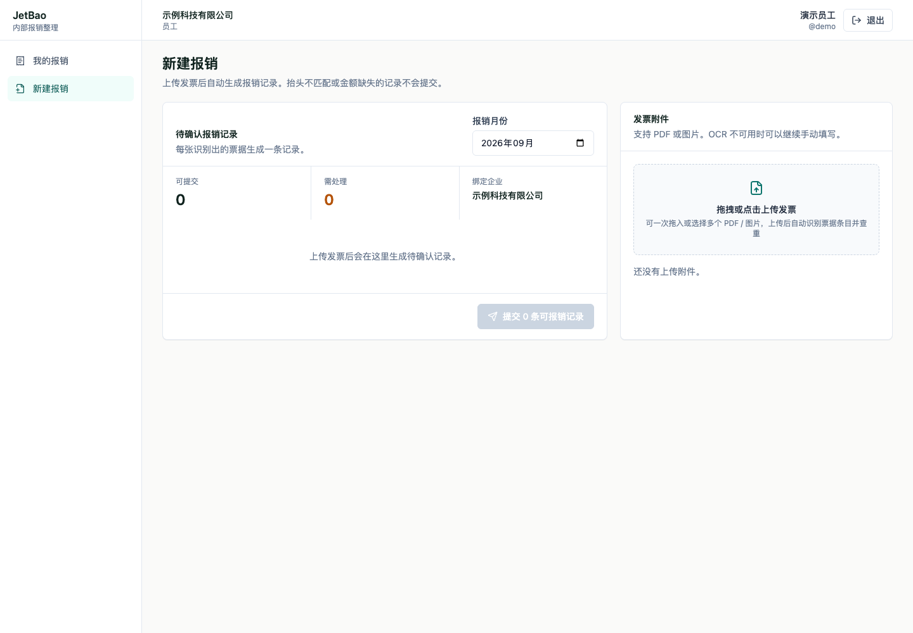
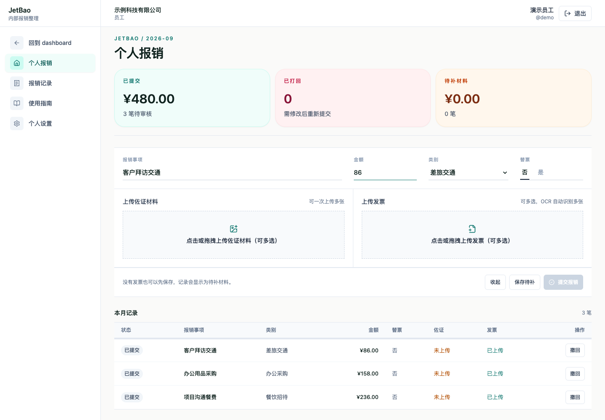
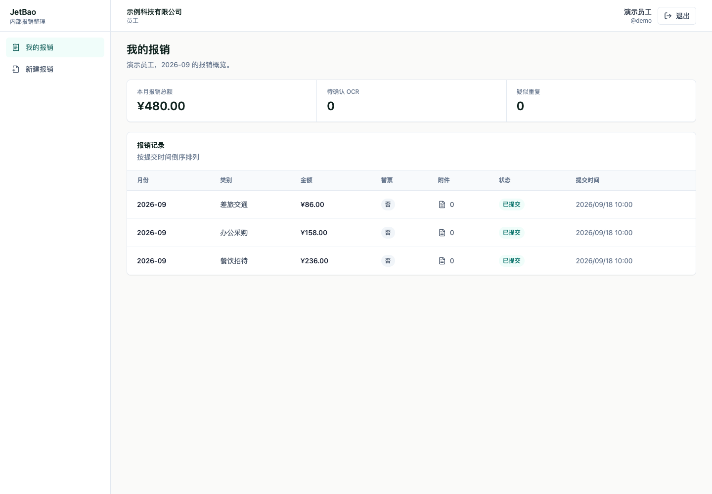
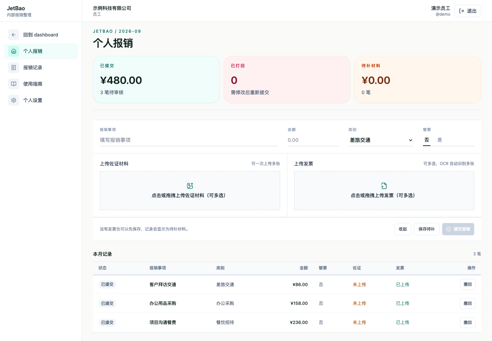
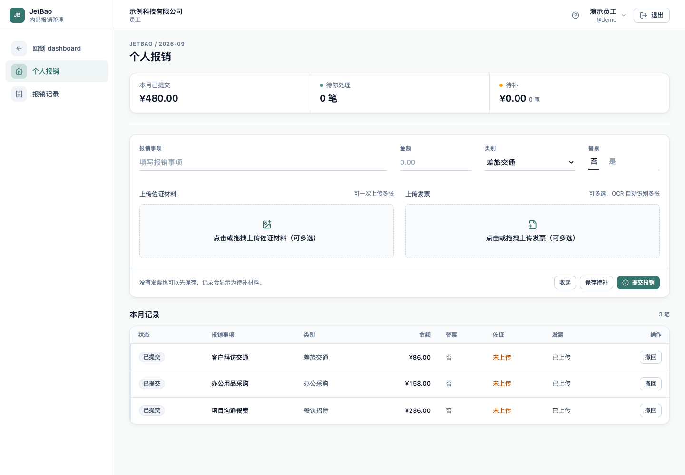

# 2026.05 起｜JetBao 从能用到用得舒服

状态：内容草稿，未发布。

## 时间线文案

我们的报销整理并不算麻烦，我只是觉得，可以有一种更舒服的实现方式。

最初，我想做的是一个平平无奇的发票上传、识别和统计流程。写完、测试过，我自认为做得不错。交给同事使用之后才发现，他最想要的“随手记一笔”，我没有做进去。替票、统计格式，以及他实际整理报销的习惯，也是在和他过流程的过程中逐渐清楚的。

于是，我又回去改。报销可以先记下来，再补发票和材料，工具也在后续使用中继续调整。

一开始的 UI 很随意，基本就是 Codex 直接做出来的样子。当时我觉得，工具类产品，能用就行。后来才一点点优化到现在。

## 界面对比

### 早期留存版本 2026-05-18

先上传发票，再生成待确认的报销记录。

### 中间版本 2026-08-26

已经可以先记录报销、再补材料；页面用三块彩色卡片区分已提交、已打回和待补材料。侧栏仍保留独立的使用指南、个人设置入口。

### 当前仓库版本 2026-09-15

先填写报销事项和金额，没有发票也可以保存待补；录入和本月记录放在同一个工作面。

### 概览补充

## 截图来源与内容边界

- 截图时间：2026-10-08。由 Git 留存代码在隔离的本地环境重新构建，不是历史原始截图，也不是生产环境截图。
- 早期：e015f3aad339ca2990736bcb6fa400cb147767b1，2026-05-18，最早可用提交。不据此断言它与交给同事试用时完全一致。
- 8 月：3f22aaadef032b6938b05e492d0f265c46937426，2026-08-26，8 月最后一个已合并版本，新增个人报销记录；选作中间阶段，不代表当月只有一次更新。
- 当前：GitHub main d2342cd3c7722eb6aa7b394440568a197fbbf555，2026-09-15；本地 f83d677ad1e4c9b12a72806608948ceeaafaf020 与该 main 的完整 tree 均为 7c03829012d51b2deaf7c9f936000ae6dce108ee。
- 三个版本使用同一组虚构员工、公司与报销样本，统一演示日期为 2026-09-20，统一视口为 1440 × 1000。截图内的月份是演示数据，不是版本日期。
- 在临时前端源码副本中替换公司名称；界面结构和样式未重设计。API 由浏览器本地 mock 返回，无真实账号、发票或业务数据，也未连接生产 API。
- 当前版本录入截图只填写了演示事项及金额，未实际提交；这些截图展示 UI 与入口，不作为后端流程验收。
- 三个前端均完成 Vite 构建，六张截图经目视检查。
- 代码记录：2026-07-06 的 e48ef2a 引入“报销整理工作台和随手记流程”；7 月继续调整状态与录入布局；9 月统一视觉 token 并改进导航和录入区。
- 最早留存代码已含替票选项，因此不把“替票”写成确定在首次交付后才添加的功能。
- 项目缘起、同事反馈与“工具能用就行”的想法来自本人此次口述，不额外推断具体开发提示词或量化效果。

## 2026-10-08 补查：两条成长线的交汇

只读核查的固定提交详见 [提交证据 J1—J6](commit-evidence-2026-10-08.md)。工程素材包括随手记接入完整状态流程、部署失败强制重建旧版本、多服务回滚镜像保护、导出范围与实际下载进度。设计素材包括 9 月语义 token、状态强调规则、指南抽屉与账号菜单收敛导航。

这些是代码证据与编辑候选，不证明当时具体采用的 AI 工具或提示词，也不等于本轮验证生产状态。已有口述与截图使 JetBao 成为目前最完整的双线案例；串联文案见 [两条成长线](two-tracks.md)。
